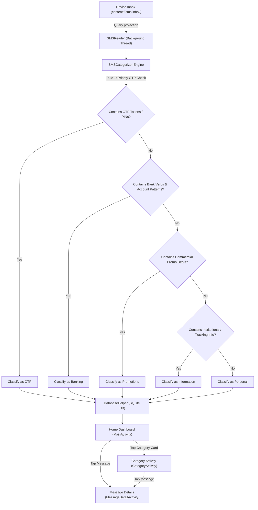

# Smart SMS Categorizer - Android Application

An intelligent, offline Android application developed for a college mini-project using **Java**, **XML**, and **SQLite** in Android Studio.

The application automatically reads existing and incoming SMS messages from the user's phone, classifies them into five distinct categories (**Banking**, **OTP**, **Information**, **Promotions**, and **Personal**), and displays them in a clean, modern card dashboard.

---

## 📱 Features

1. **Automatic SMS Categorization**:
   - **Banking**: Bank debits, credits, account updates, UPI transactions, card payments, and balance alerts.
   - **OTP (Highest Priority)**: Time-sensitive verification codes, login tokens, authentication numbers, and secret PINs.
   - **Information**: College updates, exam timetables, hall ticket alerts, doctor appointments, and courier/delivery tracking (`EKART`, `Out for Delivery`).
   - **Promotions**: E-commerce sales, discounts, coupon codes, cashback offers, and marketing campaigns.
   - **Personal**: Direct communications from 10-digit mobile numbers and general peer messages.

2. **100% Offline & Private**:
   - Zero internet permissions (`android.permission.INTERNET` is not used).
   - No external APIs, no paid services, no cloud uploads.
   - All classification and storage occur completely on-device.

3. **Local SQLite Persistence**:
   - Stores categorized messages in an offline SQLite database (`sms_categorizer.db`).
   - Prevents duplicate imports using unique SMS system identifiers (`sms_id UNIQUE` with `CONFLICT_REPLACE`).
   - Deleting a message inside the app removes only the local record; original phone SMS are **never** modified or deleted.

4. **Multi-Parameter Search**:
   - Instant search across sender name, phone number, and message text.
   - Global search on Dashboard + dedicated search within individual categories.

5. **Demo Data Generator**:
   - Includes a built-in "Load Demo SMS" button that populates realistic sample messages for all 5 categories.
   - Perfect for demonstrating the project in college labs or on emulators without a physical SIM card.

6. **Modern Material UI**:
   - Clean professional blue and white color scheme.
   - Category cards with live count chips and distinct theme colors.
   - Message details screen with one-tap clipboard copy and Android share sheet.

---

## 🛠️ Technology Stack

- **IDE**: Android Studio Ladybug / Koala / Hedgehog
- **Programming Language**: Java (JDK 11 / 17 / 21)
- **UI Design**: XML Layouts & Material Design Components
- **Local Database**: SQLite (`SQLiteOpenHelper`)
- **Android Platform**: Minimum SDK 24 (Android 7.0), Target SDK 37 (Android 15+)
- **Build System**: Gradle 9.6.0 with Android Gradle Plugin (AGP) 9.5.1

---

## 📂 Project Architecture & Directory Structure

```text
MAD/
├── app/
│   ├── build.gradle.kts                     # App-level build config & dependencies
│   └── src/
│       ├── main/
│       │   ├── AndroidManifest.xml          # Declares permissions & activities
│       │   ├── java/com/example/miniproject/
│       │   │   ├── Message.java             # SMS Data Model (Serializable POJO)
│       │   │   ├── SMSCategorizer.java      # Rule-based Categorization Engine
│       │   │   ├── DatabaseHelper.java      # SQLite Database Manager (CRUD + Search)
│       │   │   ├── SMSReader.java           # SMS Content Provider Reader (Async)
│       │   │   ├── MessageAdapter.java      # RecyclerView Adapter with custom badges
│       │   │   ├── SplashActivity.java      # Splash branding screen (1.5s delay)
│       │   │   ├── MainActivity.java        # Home Dashboard (Cards, Search, Sync)
│       │   │   ├── CategoryActivity.java    # Category-specific filtered message view
│       │   │   └── MessageDetailActivity.java # Full message detail view + actions
│       │   └── res/
│       │       ├── drawable/                # Custom vector icons & rounded backgrounds
│       │       ├── layout/                  # XML UI screen layouts
│       │       │   ├── activity_splash.xml
│       │       │   ├── activity_main.xml
│       │       │   ├── activity_category.xml
│       │       │   ├── activity_message_detail.xml
│       │       │   └── item_message.xml
│       │       └── values/
│       │           ├── colors.xml           # Palette & category theme colors
│       │           ├── strings.xml          # String resources
│       │           └── themes.xml           # MaterialComponents Light NoActionBar
│       └── test/java/com/example/miniproject/
│           └── SMSCategorizerTest.java      # Unit test suite (6 passing tests)
├── build.gradle.kts                         # Root build script
├── settings.gradle.kts                      # Module include script
└── README.md                                # Project documentation
```

---

## 🔄 How the Classification System Works



### Classification Priority Order:
1. **Rule 1 - OTP (Highest Priority)**:
   - Evaluated first because security codes and login verifications are urgent.
   - Checks keywords (`otp`, `verification code`, `security code`, `login code`, `secret code`, `passcode`, `use code`) and regular expressions matching 4–8 digit numbers near verification terms.
2. **Rule 2 - Banking**:
   - Detects transaction action verbs (`debited`, `credited`, `withdrawn`, `transferred`, `salary credited`, `spent on`) and account identifiers (`a/c`, `ac no`, `avail bal`, `card ending`, `upi ref`).
   - Also verifies corporate bank headers (`HDFCBK`, `SBIINB`, `ICICIB`, etc.).
3. **Rule 3 - Promotions**:
   - Detects commercial marketing keywords (`discount`, `flat 50%`, `cashback`, `coupon`, `promo`, `deal`, `sale`, `shop now`, `free delivery`).
4. **Rule 4 - Information**:
   - Detects service updates, courier tracking (`out for delivery`, `courier`, `shipped`), college notices (`exam`, `hall ticket`, `timetable`), and appointments (`doctor`, `scheduled meeting`).
5. **Rule 5 - Personal (Default)**:
   - Messages sent from 10–12 digit mobile phone numbers without promotional keywords and any unmatched messages default to Personal.

---

## 🚀 How to Open and Run in Android Studio

### Step 1: Open the Project
1. Launch **Android Studio**.
2. Go to **File $\rightarrow$ Open** (or click **Open** on the Welcome screen).
3. Select the outer folder:
   ```text
   C:\Users\Sruja\Desktop\MAD
   ```
   *(Important: Do not select the `app` folder; select the `MAD` folder).*

### Step 2: Sync Gradle
1. When prompted by the yellow banner at the top of the editor, click **"Sync Now"**.
2. Or go to menu: **File $\rightarrow$ Sync Project with Gradle Files**.
3. Wait for the build sync to finish.

### Step 3: Run the App
1. Connect your Android phone via USB (with **USB Debugging** enabled in Developer Options) OR start an Android Emulator from Device Manager.
2. Ensure the top configuration dropdown is set to **`app`**.
3. Click the green **Run ▶** button (or press `Shift + F10`).

---

## 🧪 Testing Scenarios

| Test Case | Steps | Expected Result |
| :--- | :--- | :--- |
| **1. Splash Screen** | Open app | Displays logo & title for 1.5 seconds, then enters dashboard |
| **2. Permission Denial** | Click "Don't allow" when asked for SMS permission | Permission banner remains with warning; app does not crash |
| **3. Demo SMS Testing** | Click "Load Demo SMS" button | 15 realistic messages load across all 5 categories with updated counts |
| **4. Permission Granted** | Click "Grant Permission" $\rightarrow$ "Allow" | Inbox SMS are read asynchronously, categorized, and counts update |
| **5. Banking Category** | Tap Banking Card | Displays only bank debits, credits, and balance alerts |
| **6. OTP Category** | Tap OTP Card | Displays only verification codes and authentication passwords |
| **7. Search Function** | Type a keyword (e.g. `HDFC` or `50%`) in the search box | Instantly displays matching results across all categories |
| **8. Message Details & Copy**| Tap any message $\rightarrow$ Tap "Copy Message" | Full text is copied to clipboard with confirmation toast |
| **9. Local Deletion** | Tap trash icon in details $\rightarrow$ Confirm | Record is removed from app SQLite database; phone SMS is unaffected |
| **10. Persistence Check** | Force close app and reopen | All categorized messages and counts remain saved offline |

---

## 📦 Ready-to-Install APK

The project has already been compiled into a standalone debug APK:
- **Path**: `app/build/outputs/apk/debug/app-debug.apk`
- You can transfer this APK directly to any Android smartphone (Android 7.0+) and install it without Android Studio.

---

## 🎓 College Viva Questions & Answers

1. **Q: Which component reads SMS in Android?**  
   *A:* Android's `ContentResolver` querying `Telephony.Sms.Inbox.CONTENT_URI` (`content://sms/inbox`).

2. **Q: Why is SMS permission considered a dangerous permission?**  
   *A:* SMS messages contain sensitive personal and financial data. Google requires explicit user runtime consent (`READ_SMS`) starting with Android 6.0 (API 23).

3. **Q: Why does the app not use Machine Learning?**  
   *A:* Rule-based keyword matching runs 100% on-device with zero latency, zero cloud dependencies, low battery consumption, and a tiny APK size (< 7 MB).

4. **Q: How are duplicates prevented during sync?**  
   *A:* The SQLite database table defines `sms_id TEXT UNIQUE`. The insert query uses `CONFLICT_REPLACE` to update existing records instead of duplicating them.

5. **Q: Does this app send user data to any external server?**  
   *A:* No. The app does not request internet permission (`android.permission.INTERNET`). All processing is completely local and private.
